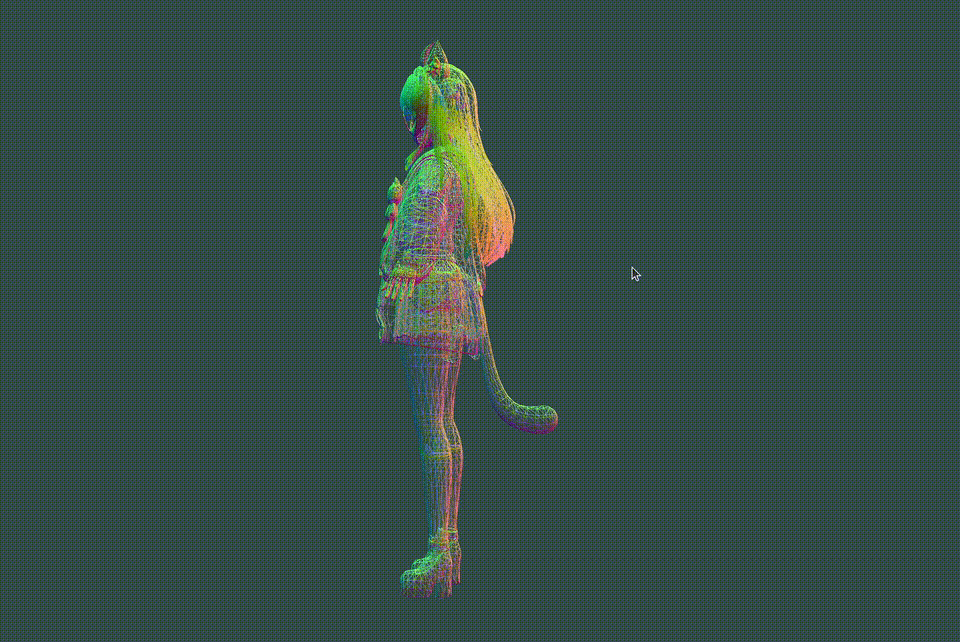

# Scop

## Demo

## Project Scope

The goal of this project is to develop a solution that meets the requirements and objectives defined by the 42 School curriculum. It focuses on applying programming fundamentals, problem-solving skills, and software development practices through hands-on implementation.

The project is developed in accordance with the subject requirements, with an emphasis on understanding the underlying concepts, writing maintainable code, and following the constraints and coding standards established by 42 School.

This repository contains the implementation, source code, and related resources required to complete the project.

